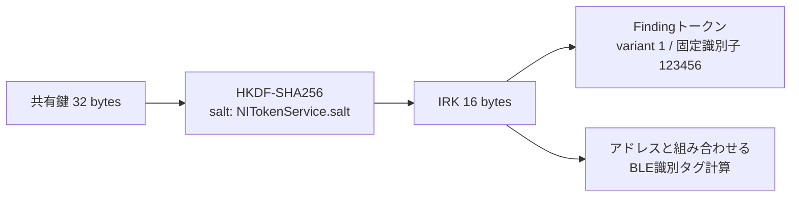

# 探索トークンの生成・更新・配送経路

2026-10-31。AndroidアプリだけでiPhone 17を探索するための継続調査です。今回は**共有鍵からトークン本体へ進む処理、更新番号の計算、所有者向け要求の実際の配送先**を追いました。取得済みOSの静的解析と、固定ダミー値だけを使うメモリ内の関数照合です。

**所有者の実際の共有鍵を取得したり、AndroidからiPhoneとのUWB測距に成功したりしたものではありません。** 実アカウント、Keychain、アカウントDBにはアクセスせず、IDS送信・CloudKit要求・BLE広告・UWB・サウンドを開始していません。製品APKも変更していません。

## 対象と根拠

| 対象 | 識別情報 |
| --- | --- |
| macOS | 27.2 / 26B123 / arm64e |
| `findmylocateagent` の解析用thin arm64e | SHA-256 `3fa66a368a6e8432bd2029b33ecdfff26ff0bcaec7c6982f870b82e7c894bbc9`。元のfatバイナリのハッシュは[前回の記録](UWB-24A446.md)を参照 |
| macOS `NearbyInteraction` | LC_UUID `6953ABC7-C4C6-3808-B319-6976202381B2`、source version 575.0.10.0.0 |
| macOS `FindMyCrypto` | LC_UUID `C52FB511-DB4D-3F8C-8F76-DE0978E6B886`、source version 106.21.6.16.7 |
| iOS `NearbyInteraction` | iPhone18,3 / iOS 27.0.1 / 24A446の取得済みDeviceSupport。今回の実行照合はMac版のみ |

以下のアドレスは、この取得物の静的仮想アドレスです。他のOSへ固定アドレスを転用しません。OSバイナリ・逆アセンブル全文・私的アカウント情報はGitへ含めません。

## 1. 共有鍵・IRK・セッション鍵は別の値

`FindMyCrypto.SharedSecretKey.length` (`0x28adaa828`) は32を返します。受信処理 (`0x1003f940c`) はエンベロープのDataを、この型の `KeyRepresenting.init(rawValue:)` で検証します。長さ情報を使う内部コンストラクターへ進み、作成できなければinvalid shared secretの分岐になります。実際の受信データではなくコードによる確認です。

その共有鍵から `NITokenService` がHKDF-SHA256で16バイトを導出します。この16バイトが、今回確認したFindingトークンの**IRKそのもの**でした。macOSの `NISession.generateFindingDiscoveryTokenWithSharedSecret:` (`0x1df7cf314`) は長さ16を要求し、`0x1e00d8df0` のObjective-Cディスパッチを通じて `NIDiscoveryToken.generateFindingTokenWithIRK:` を呼びます。この間に別の鍵導出はありません。



これは[相互認証用の32バイトCCM鍵](UWB-24A446.md#1-セッション鍵)とは別段階です。WebのデバイスIDやログインパスワードから、所有者の共有鍵を作れるという意味ではありません。

## 2. トークンのOPACK構造をダミー値で照合

macOSの `generateFindingTokenWithIRK:` (`0x1df7d396c`) は、概念上次の辞書をOPACKへ変換します。

```text
{
    7: 1,                         // Finding token variant
    2: Data(IRK[16]),
    1: Data(12 34 56)              // 固定の3バイト識別子
}
```

定数NSNumberの値とスタック上のキー／値の並びを確認しました。固定識別子はMacの `0x1df8043f6` とiOSの `0x24b382936` の両方で `12 34 56` です。iOSの対応する生成関数は `0x24b35869c` にあります。

さらに、Macの **NIDiscoveryTokenだけのメモリ内の生成関数とgetter** を、昇順16バイト・全0・全FFという3つの固定IRKで呼びました。NISessionは作成していません。IRKが入力と同一、識別子が全件 `123456`、variantが全件1であることを確認しました。

昇順IRKの場合、`rawToken` の全26バイトは次の値になりました。

```text
e3 09 73 12 34 56 0f 09 0a 80 00 01 02 03 04 05 06 07 08 09 0a 0b 0c 0d 0e 0f
```

[verify_uwb_token_flow.py](../tools/verify_uwb_token_flow.py) の限定的なエンコーダーも、3件すべてで実際のMac関数の出力と一致しました。辞書の順序が異なる等価なOPACKを否定するものではありません。

このrawTokenをそのままBLEへ送るわけではありません。NSSecureCodingの輸送形式、設定交換メッセージ、広告本体は別です。ここでの3バイトの識別子と、暗号化用の8バイトsession identifierも区別します。また、固定の `123456` は所有者を認証する秘密値ではありません。[BLE広告の識別子](UWB-DISCOVERY.md#2-探索の識別は2経路で異なる)はIRKと広告アドレス等から計算されるため、固定識別子だけで対象へ接続できません。別のtoken variant、BeaconIdentifier、`forExternalUse:` の全形式を実装したともしていません。

## 3. 所有者用のinfoなし経路と、番号を変える経路

前回確認したHKDFのinfoには、呼び出し元によって次の違いがあります。

| 経路 | info | 今回の確認 |
| --- | --- | --- |
| `ownerToken(date:)` の生成呼び出し `0x1003e4e30` | 空 | flag=1。ここを7日ごとに変わるトークンと扱わない |
| bucketを使用する呼び出し `0x100403ec4` / `0x100408b14` | `uint64_le(bucket.index)`、8バイト | flag=0。後者にはincomingSharedSecretが必要な分岐がある |

`sub_100405118` は `keyRollIntervalInMinutes` の設定値を読み、設定がない分岐で `0x2760`、つまり10,080分＝7日を返します。**これは解析したMac版の静的な既定値です。実機iPhoneの運用周期や、現在のMacの設定値を確認した結果ではありません。** 実際の設定値も読み出していません。

`sub_100404214` の番号計算は、単純な「共有鍵のbaseDateから7日ずつ」ではなく、Foundationの2001-01-01 UTC基準でbaseDateを区間境界へ揃えます。有限の日時と正の周期に対する読み取りは次の形です。

```text
period = minutes * 60
anchor = floor(baseDate.referenceSeconds / period) * period
effectiveDate = max(baseDate, date)
index = UInt64((effectiveDate.referenceSeconds - anchor) / period) + 1
start = anchor + (index - 1) * period
endUnix = nextDown(start.unixSeconds + period)
```

`0x1004045c8`〜`0x1004046dc` に周期への変換・floor・UInt64への変換・+1があり、終了点は `0x100404774`〜`0x1004047b0` で次の境界より小さいDoubleへ1段進めます。終了点を1ミリ秒手前と近似しません。

静的コードから作ったモデルに対し、境界前後、baseDateより前の日時、2001年より前、周期設定の変更など8件を確認しました。それぞれのindexを使うHKDFもCommonCryptoと一致します。**bucket関数をデーモン内で実行して照合した結果ではありません。**

## 4. `requestOwnerToken` の行き先を追跡

`FriendshipProtocol.requestOwnerToken(force:)` は名前だけではWebのトークン取得口を示しませんでした。今回のMac版では次の経路を確認しています。

1. 実装側 `0x1002ac0dc` の継続処理は、`0x1002ac3f4` で `NITokenService_LocalMessaging` の型情報を取得する。
2. async関数記述子 `0x1004c6610` から `0x1003e1084` に進む。
3. 継続関数の文字列は `sendOwnerTokenToConnectedDevice(force:)`。`0x1003e15cc` は `LocalMessaging.connectedDevice` を読み、`0x1003e1764` には接続端末がない場合の分岐がある。

対応するローカルメッセージ型には `ownerSharedSecret` / `ownerSharedSecretRequest` と、companionのPeople Finding capabilityの交換があります。**接続済み端末へ所有者情報を送る経路であり、任意のAndroidからiCloud WebのCookieだけで要求できるHTTP APIではありません。** どの所有端末間で成立するか、Androidが正規の相手として参加できるかは未確認です。

## 5. 所有者の保存領域と友だちの配送を区別する

| 対象 | 確認できた構造・処理 |
| --- | --- |
| 所有者の共有鍵 | `OwnerSharedSecretsRecord`。id、type、sharedSecret、baseDate。`LocalStorageService` に専用のtable queueがあり、`ownerSharedSecretRecord()` の実装候補は `0x1002f696c` / `0x1002f712c` |
| 友だちとの共有鍵 | `FriendSharedSecretsRecord`。incoming / outgoingそれぞれのsharedSecretとbaseDate。`CloudKitBacked` への適合がある |
| 友だちへの要求 | `FindingTokenRequestEnvelopeV1.serverId`。送信側 `0x10041dff8` にはprimary accountの確認とIDSで要求する処理がある |
| 友だちからの受信 | `FindingTokenEnvelopeV1` はserverId、baseDate、sharedSecret。`0x1003f8b8c` はFollowing / handleとの対応、peerID、SharedSecretKeyの検証に進む |

`OwnerSharedSecretsRecord` に今回確認できたのはEncodable / Decodable等への適合です。友だち側にある `CloudKitBacked` を、所有者のレコードへそのまま当てはめません。incoming / outgoingという名前だけから、無線上の役割や対象iPhoneの所有鍵を推定することもしません。

これにより、共有鍵が単にWebの位置応答から取り出せるという前提は置けなくなります。**必要なのは正しい対象・アカウントに対応する共有鍵を、認証済みの配送経路で取得できること**です。今回、その取得は実装していません。ローカルの実レコードを読むMacブリッジへの置き換えも行っていません。

## 再現と検証

コードは役割別に分割し、アドレス解析・トークン生成の照合・Objective-Cヘルパーを別ファイルにしています。

```bash
python3 tools/test_macho_references.py
python3 tools/verify_uwb_token_flow.py --output research/uwb-token-flow/synthetic-token-flow.json
python3 tools/verify_uwb_token_index.py --output research/uwb-token-flow/integer-regression.json
python3 tools/verify_uwb_discovery.py --output research/uwb-token-flow/discovery-regression.json
python3 tools/verify_uwb_crypto.py --output research/uwb-token-flow/crypto-regression.json
```

| 検証 | 結果 |
| --- | --- |
| Macのトークン生成・getterと限定OPACKエンコーダー | 固定IRK 3件で一致 |
| 静的bucketモデルの境界等 | 8件成功 |
| 各bucketのHKDFとCommonCrypto | 8件一致 |
| エンコーダーへのIRK長0 / 3 / 15 / 17 / 32 | 全5件を拒否 |
| アドレスデコーダー、PAGEZEROを含むコンパイラー生成Mach-Oの静的参照 | 5テスト成功。生成した実行ファイルは起動しない |

[inspect_macho_references.py](../tools/inspect_macho_references.py) は、明示した文字列に対する隣接ADRP/ADDと、指定したimport／アドレスへの直接B/BLだけを探します。asyncの継続関数もLC_FUNCTION_STARTSに基づく単位で表示します。間接呼び出しや完全なデータフローを自動復元するツールではありません。候補アドレスは必ず逆アセンブルで照合しています。

同じ取得物を手元に用意した場合、例えば次の条件で配送候補と導出処理の参照を再検索できます。

```bash
python3 tools/inspect_macho_references.py \
  research/uwb-ios27/findmylocateagent-mac-arm64e \
  --version-label 'macOS 27.2 26B123 arm64e' \
  --contains 'sendOwnerTokenToConnectedDevice(force:)' \
  --contains 'no connected device' \
  --calls-address 0x100404dac \
  --output research/uwb-token-flow/references.json
```

公開の[Appleのサンプル](https://developer.apple.com/documentation/nearbyinteraction/finding-devices-with-precision)は両側のアプリとMultipeerConnectivityでのトークン交換を前提にしています。今回見つけた標準「探す」の配送経路が、Androidの公開UWB APIへそのまま対応するとは確認できていません。

次の課題は、iPhoneのデバイス探索に使う正規の共有鍵配送をこのPeople Finding／companion経路から切り分けること、実際の対象との対応付け、NBAMMSの設定交換とGalaxyの無線モードの対応です。現時点で距離・方向は測定できません。
